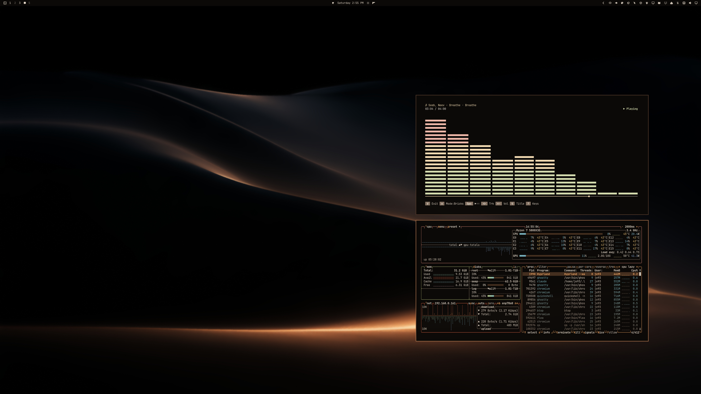

# Ember Dunes

Dunes at night: almost all shadow, with one copper glow along the ridges. A dark theme for Omarchy.



## Install

For **Omarchy 4 with Omarchy Shell**:

```sh
omarchy theme install https://github.com/erikrjohansson/omarchy-ember-dunes-theme
```

Use `omarchy theme bg next` to switch between the dune and wordmark wallpapers.

## Update

```sh
omarchy theme update
```

## Remove

```sh
omarchy theme remove ember-dunes
```

## The theme

- Windows, menus and notifications in a warm black, with the ridges' copper glow as the accent.
- Terminal colors taken from the wallpaper: copper, warm sand and the slate light on the upper dunes.
- A top bar that follows your Omarchy bar setting.
- GTK 3 / GTK 4 styling and yellow Yaru folder icons.
- Application configs derive from `colors.toml` through Omarchy templates.

## Wallpapers

Two **6016 × 3384** wallpapers are included.

[Dune ridgeline](backgrounds/01-ember-dunes-ridgeline.jpg) · [Wordmark](backgrounds/02-ember-dunes-wordmark.jpg)

## License

[MIT](LICENSE) · [Omarchy artwork attribution](THIRD_PARTY_NOTICES.md)
